# Lab 06 – Exploring Scapy: Crafting, Sending and Sniffing Network Packets

A beginner-friendly, step-by-step manual for **Scapy**, the Python library for building, sending, capturing and dissecting network packets.

You do **not** need a networking or IT background to follow this guide. Every command is explained in plain language, followed by the real output from the lab so you can check that your own result matches.

> **Safety note:** Only run these experiments on your own lab VM or on networks where you have permission. The port scanner in the bonus section must only be used on machines you own or are authorised to test.

---

## Table of Contents

1. [What you will learn](#1-what-you-will-learn)
2. [Background: packets in plain English](#2-background-packets-in-plain-english)
3. [Lab environment and setup](#3-lab-environment-and-setup)
4. [Repository structure](#4-repository-structure)
5. [Lesson 1 – Exploring Scapy from the inside out](#5-lesson-1--exploring-scapy-from-the-inside-out)
6. [Lesson 2 – Crafting your first packet](#6-lesson-2--crafting-your-first-packet)
7. [Lesson 3 – The stacking operator `/`, `show()` vs `show2()`](#7-lesson-3--the-stacking-operator--show-vs-show2)
8. [Lesson 4 – Packets as real bytes and hex](#8-lesson-4--packets-as-real-bytes-and-hex)
9. [Lesson 5 – Inspecting and modifying packets](#9-lesson-5--inspecting-and-modifying-packets)
10. [Lesson 6 – Sending and receiving](#10-lesson-6--sending-and-receiving)
11. [Lesson 7 – Live sniffing and packet dissection](#11-lesson-7--live-sniffing-and-packet-dissection)
12. [Hands-on challenges](#12-hands-on-challenges)
13. [Bonus exercises](#13-bonus-exercises)
14. [Quick reference cheat sheet](#14-quick-reference-cheat-sheet)
15. [Glossary](#15-glossary)
16. [Troubleshooting](#16-troubleshooting)
17. [Summary](#17-summary)

---

## 1. What you will learn

By the end of this lab you will be able to:

- Explore any protocol inside Scapy with `ls()` and `lsc()` instead of memorising RFC documents.
- Build packets layer by layer using Python objects and the `/` operator.
- Explain the difference between `show()` and `show2()`.
- View a packet as raw bytes and read a hex dump.
- Read, check and modify fields inside a packet.
- Send packets with `send()` and `sr1()` and read the reply.
- Capture live traffic with `sniff()`, filter it with BPF and process it in real time.
- Write small tools: a DNS-query sniffer, a DNS requester and a simple port scanner.

---

## 2. Background: packets in plain English

Data on a network never travels as one big lump. It is cut into small pieces called **packets**. Think of a packet as a **letter inside nested envelopes**:

| Layer (envelope) | What it holds | Scapy class |
|---|---|---|
| Ethernet (Layer 2) | Local delivery: MAC addresses | `Ether` |
| IP (Layer 3) | Where the packet goes: source and destination IP address, TTL | `IP` |
| TCP / UDP / ICMP (Layer 4) | How it is delivered: ports, flags (TCP/UDP) or ping messages (ICMP) | `TCP`, `UDP`, `ICMP` |
| Payload | The actual data | `Raw` |

Each layer has a **header**: a small block of fields (version, TTL, ports, checksum, …) that the receiving computer reads to know what to do with the packet.

**Scapy** lets you create each of those headers as a Python object, change any field you like and send the result. Because it is plain Python, it is ideal for learning how networks really work.

---

## 3. Lab environment and setup

| Item | Value used in this lab |
|---|---|
| Operating system | SEED Ubuntu VM (Linux) |
| Python | 3.8.5 |
| Scapy | 2.4.4 |
| User / privileges | `seed`, using `sudo` |
| VM IP address | `10.0.2.15` |

### Install Scapy (if it is not already installed)

```bash
pip3 install scapy
# or
pip3 install -r requirements.txt
```

### Why `sudo`?

Sending and sniffing packets uses *raw sockets*, which only the administrator (root) is allowed to open. So always start Scapy with `sudo`.

### Two ways to work

**A) Scapy's interactive shell** (used for most screenshots)

```bash
sudo scapy
```

**B) Plain Python shell or script**

```bash
sudo python3                      # interactive
sudo python3 scripts/<file>.py    # run a ready-made script
```

You will see a prompt `>>>`. Type the code after the prompt and press Enter.

---

## 4. Repository structure

```
scapy-lab-07/
├── README.md              <- this manual
├── requirements.txt
├── images/                <- screenshots used in this manual
└── scripts/
    ├── 01_explore_layers.py
    ├── 02_craft_packets.py
    ├── 03_stacking_show_show2.py
    ├── 04_bytes_hexdump.py
    ├── 05_inspect_modify.py
    ├── 06_send_and_receive.py
    ├── 07_sniff_basics.py
    ├── 08_sniff_callback.py
    ├── 09_dns_sniffer.py
    ├── 10_challenges.py
    ├── 11_bonus_pcap_save_load.py
    ├── 12_bonus_dns_request.py
    └── 13_bonus_port_scanner.py
```

Every lesson below names the matching script.

---

## 5. Lesson 1 – Exploring Scapy from the inside out

Before writing scripts, the best way to learn Scapy is to look around inside it. Start the Scapy shell:

```bash
sudo scapy
```

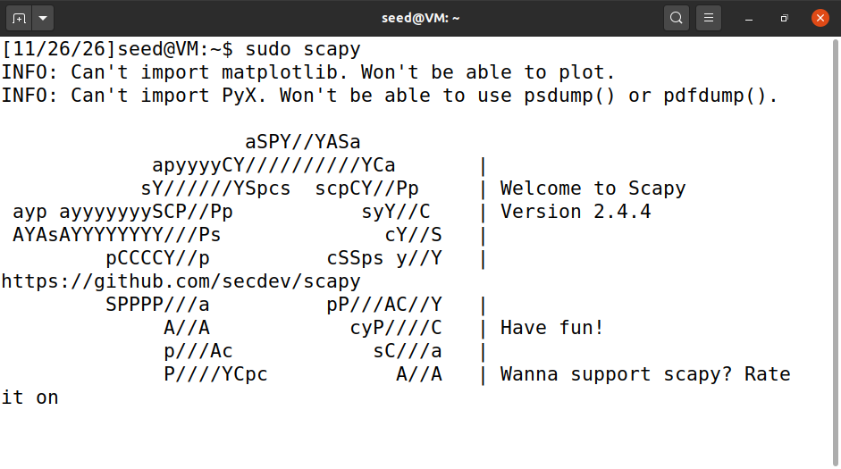

*Figure 1 – Scapy 2.4.4 starts and shows the `>>>` prompt. The INFO/WARNING lines about matplotlib, PyX and IPython are harmless; they only mean optional extras (plotting and auto-completion) are not installed.*

### 5.1 `lsc()` – list all Scapy commands

```python
from scapy.all import ls, lsc, IP, TCP, ICMP
lsc()
```

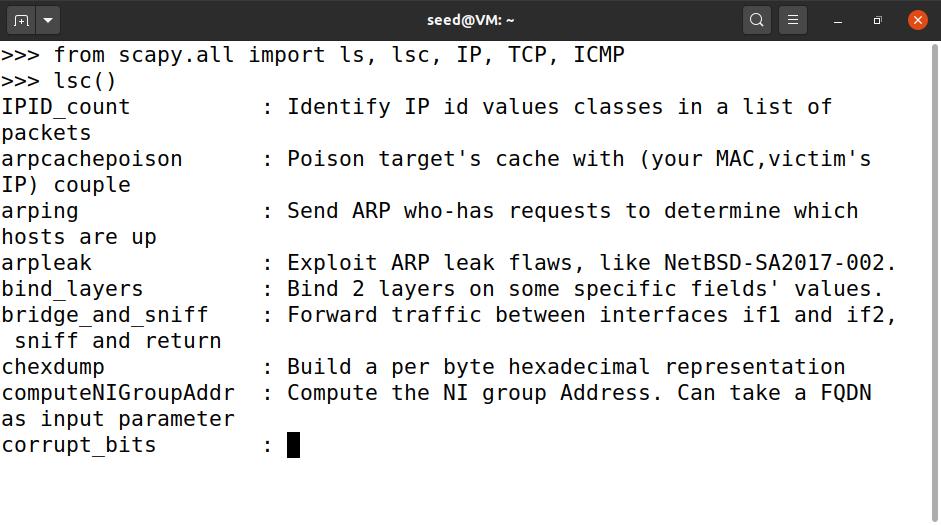

*Figure 2 – `lsc()` prints every command Scapy offers (`send`, `sniff`, `rdpcap`, `sr1`, `arping`, `fragment`, …) with a one-line description.*

### 5.2 `ls()` – list all protocols

`ls()` with no argument lists the 500+ protocols Scapy understands.

### 5.3 `ls(Layer)` – show every field of a protocol

```python
print("--- Fields in an IP Header ---")
ls(IP)
```

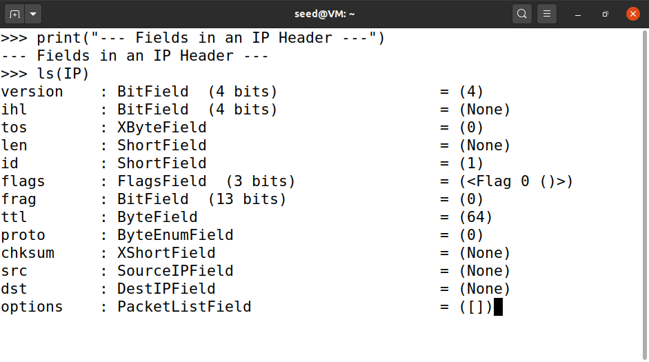

*Figure 3 – All fields of the IP header with their data type and default value.*

**What to notice**

| Field | Default | Meaning |
|---|---|---|
| `version` | `4` | IPv4 |
| `ttl` | `64` | Time To Live: how many routers the packet may pass before being dropped |
| `proto` | `0` | Which protocol is inside (filled in automatically when you stack a layer on top) |
| `chksum` | `None` | Error-check value. Scapy calculates it automatically when the packet is built |
| `src` / `dst` | `None` | Filled in automatically when needed |

**Takeaway:** you never have to memorise header formats. Run `ls(Protocol)` any time (for example `ls(TCP)`, `ls(ICMP)`).

*Script: `scripts/01_explore_layers.py`*

---

## 6. Lesson 2 – Crafting your first packet

A **layer** is simply a Python object created from a class.

### 6.1 Creating a single layer

```python
from scapy.all import IP

my_packet = IP()
print("Source IP:", my_packet.src)
print("Destination IP:", my_packet.dst)
print("TTL:", my_packet.ttl)
```

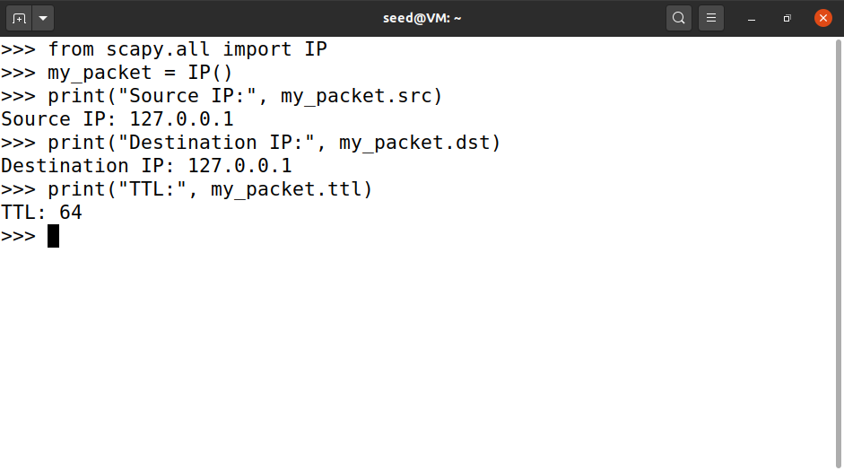

*Figure 4 – A default IP packet.*

Result: source `127.0.0.1`, destination `127.0.0.1`, TTL `64`. Because no destination was given, Scapy uses the local machine (`127.0.0.1`, called *localhost* or *loopback*) and therefore also picks `127.0.0.1` as the source. When you set a real destination (e.g. `1.1.1.1`), Scapy chooses your VM's own address (`10.0.2.15`) as the source – you will see this in Lesson 3.

### 6.2 Customising fields on creation

Any field shown by `ls(IP)` can be passed as a keyword argument:

```python
custom_ip = IP(dst="8.8.8.8", ttl=128)
print("Custom Dest:", custom_ip.dst)
print("Custom TTL:", custom_ip.ttl)
```

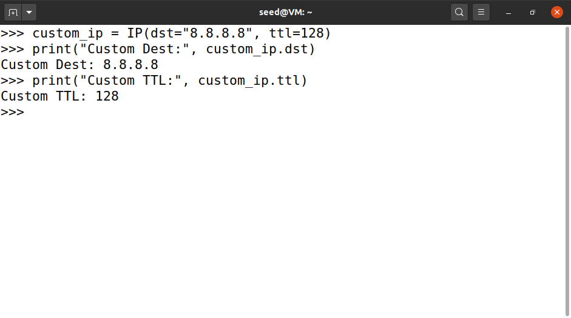

*Figure 5 – Destination and TTL changed while creating the packet.*

### 6.3 Another layer: TCP

```python
from scapy.all import TCP

t = TCP(dport=443)
print("Source Port:", t.sport)
print("Destination Port:", t.dport)
```

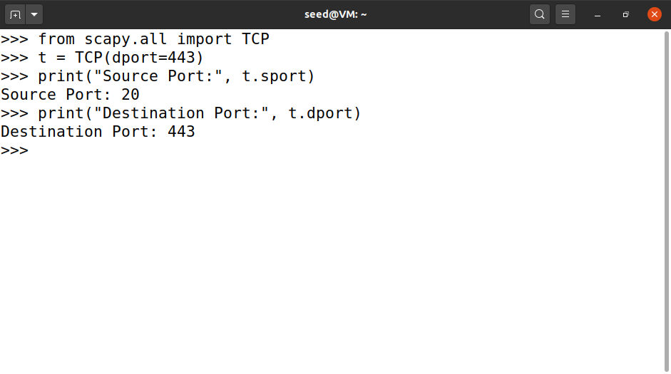

*Figure 6 – A TCP layer with destination port 443 (HTTPS). The source port was not set, so Scapy used its default, `20`.*

*Script: `scripts/02_craft_packets.py`*

---

## 7. Lesson 3 – The stacking operator `/`, `show()` vs `show2()`

### 7.1 Stacking layers

Scapy re-uses Python's division sign `/` to glue layers together. **Leftmost = outer layer (lower OSI layer); rightmost = inner layer / payload.**

```
Layer 3  /  Layer 4  /  Payload
IP()     /  TCP()    /  Raw("data")
```

### 7.2 Example: building a ping (ICMP Echo Request)

```python
from scapy.all import IP, ICMP, Raw

ping_pkt = IP(dst="1.1.1.1") / ICMP() / Raw(b"Hello World")

print("--- Summary ---")
print(ping_pkt.summary())

print("\n--- Detailed Tree View ---")
ping_pkt.show()
```

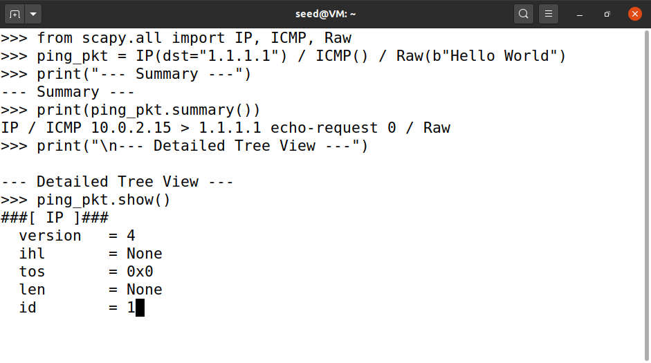

*Figure 7 – `summary()` gives a one-line description; `show()` prints the full tree: an IP layer, an ICMP layer and the `Raw` payload `'Hello World'`.*

Read the summary line:

```
IP / ICMP 10.0.2.15 > 1.1.1.1 echo-request 0 / Raw
```

It means: an IP packet carrying an ICMP *echo-request* (a ping) from `10.0.2.15` to `1.1.1.1`, with a raw data payload.

### 7.3 Critical concept: `show()` vs `show2()`

```python
ping_pkt.show()     # what YOU defined
ping_pkt.show2()    # what Scapy would actually put on the wire
```

**`show()`** – checksums and lengths are still `None`:

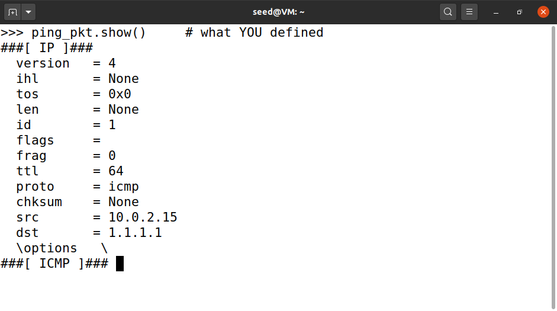

*Figure 8 – `show()`: `ihl= None`, `len= None`, `chksum= None`.*

**`show2()`** – Scapy builds the real packet, calculates lengths and checksums and then re-reads it as if it had arrived from the network:

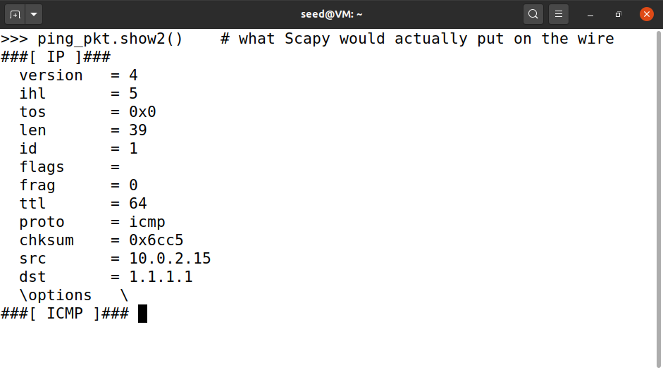

*Figure 9 – `show2()`: all values are now filled in.*

| Field | `show()` | `show2()` |
|---|---|---|
| IP `ihl` (header length) | `None` | `5` (5 × 4 = 20 bytes) |
| IP `len` (total length) | `None` | `39` (20 IP + 8 ICMP + 11 payload bytes) |
| IP `chksum` | `None` | `0x6cc5` |
| ICMP `chksum` | `None` | `0xa631` |

**Teacher's note:** use `show2()` to verify the checksums and length fields Scapy calculates automatically before sending.

*Script: `scripts/03_stacking_show_show2.py`*

---

## 8. Lesson 4 – Packets as real bytes and hex

The friendly Python objects are really **binary data** that travels over a wire. You can look at that data directly:

```python
from scapy.all import IP, ICMP, hexdump

pkt = IP(dst="192.168.1.1") / ICMP()

raw_bytes = bytes(pkt)
print("Raw Bytes:", raw_bytes)
print("Packet Length in bytes:", len(raw_bytes))

print("\n--- Hex Dump ---")
hexdump(pkt)
```

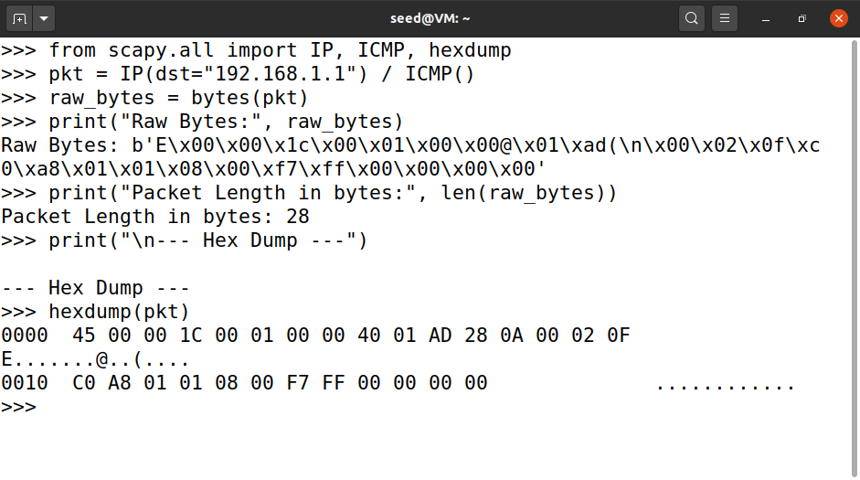

*Figure 10 – The packet is 28 bytes long (20-byte IP header + 8-byte ICMP header). The hex dump is the classic Wireshark-style view.*

### How to read the hex dump

```
0000  45 00 00 1C 00 01 00 00 40 01 AD 28 0A 00 02 0F
0010  C0 A8 01 01 08 00 F7 FF 00 00 00 00
```

| Bytes | Meaning |
|---|---|
| `45` | **4** = IP version 4, **5** = header length 5 × 4 = 20 bytes |
| `00` | Type of service |
| `00 1C` | Total length = 28 bytes |
| `00 01` | Identification |
| `00 00` | Flags / fragment offset |
| `40` | TTL = 64 |
| `01` | Protocol = 1 (ICMP) |
| `AD 28` | IP header checksum |
| `0A 00 02 0F` | Source IP = 10.0.2.15 |
| `C0 A8 01 01` | Destination IP = 192.168.1.1 |
| `08 00` | ICMP type 8 (echo request), code 0 |
| `F7 FF` | ICMP checksum |
| `00 00 00 00` | ICMP identifier and sequence number |

**Key idea:** Scapy is simply a *compiler* that turns Python objects into raw network bytes.

*Script: `scripts/04_bytes_hexdump.py`*

---

## 9. Lesson 5 – Inspecting and modifying packets

### 9.1 Reading fields and checking layers

```python
from scapy.all import IP, TCP, ICMP

pkt = IP(src="10.0.0.1", dst="10.0.0.2") / TCP(sport=1234, dport=80, flags="S")

# Access fields through the layer name
print("Destination IP:", pkt[IP].dst)
print("Destination Port:", pkt[TCP].dport)
print("TCP Flags:", pkt[TCP].flags)

# Does a layer exist?
if pkt.haslayer(TCP):
    print("This packet contains TCP!")
if not pkt.haslayer(ICMP):
    print("This packet does NOT contain ICMP!")
```

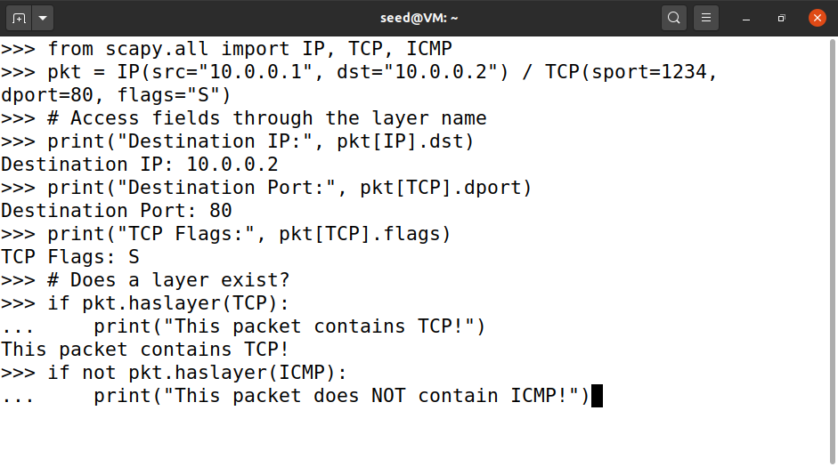

*Figure 11 – `haslayer()` returns True/False depending on whether the layer is in the packet. Here the packet has TCP but not ICMP.*

`flags="S"` means the **SYN** flag: "I would like to start a connection".

### 9.2 Modifying values

```python
# Change the destination port on the fly
pkt[TCP].dport = 443

# Add a payload to an existing packet
pkt = pkt / "New Payload Added Later"
pkt.show()
```

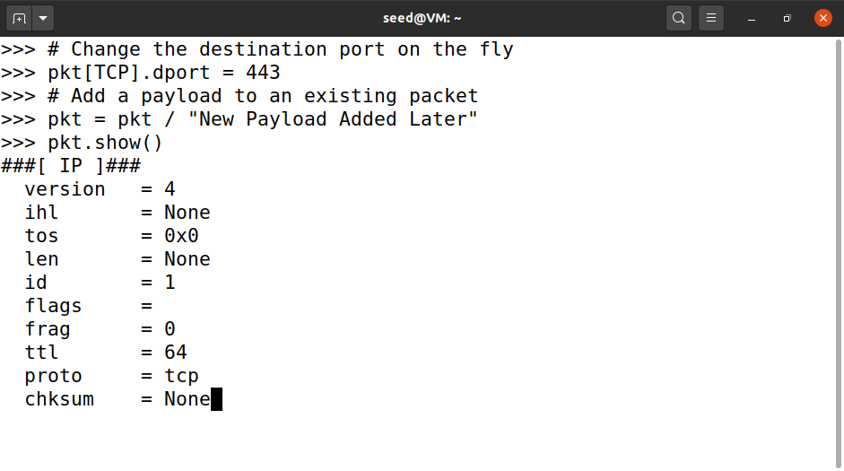

*Figure 12 – `dport` is now `https` (Scapy shows well-known port names; 443 = HTTPS) and a `Raw` payload was appended at the end.*

*Script: `scripts/05_inspect_modify.py`*

---

## 10. Lesson 6 – Sending and receiving

Which Scapy function should you use?

| Function | Layer | Expects reply? | Returns |
|---|---|---|---|
| `send()` | 3 (IP) | No | `None` |
| `sendp()` | 2 (Ethernet) | No | `None` |
| `sr()` | 3 (IP) | Yes (multiple) | (answered, unanswered) |
| `sr1()` | 3 (IP) | Yes (first reply only) | one reply packet or `None` |
| `srp()` / `srp1()` | 2 (Ethernet) | Yes | answered/unanswered pairs |

### 10.1 `send()` – fire and forget

```python
from scapy.all import IP, ICMP, send

pkt = IP(dst="8.8.8.8") / ICMP()

print("[*] Sending one ping packet...")
send(pkt, verbose=False)
print("[+] Sent!")
```

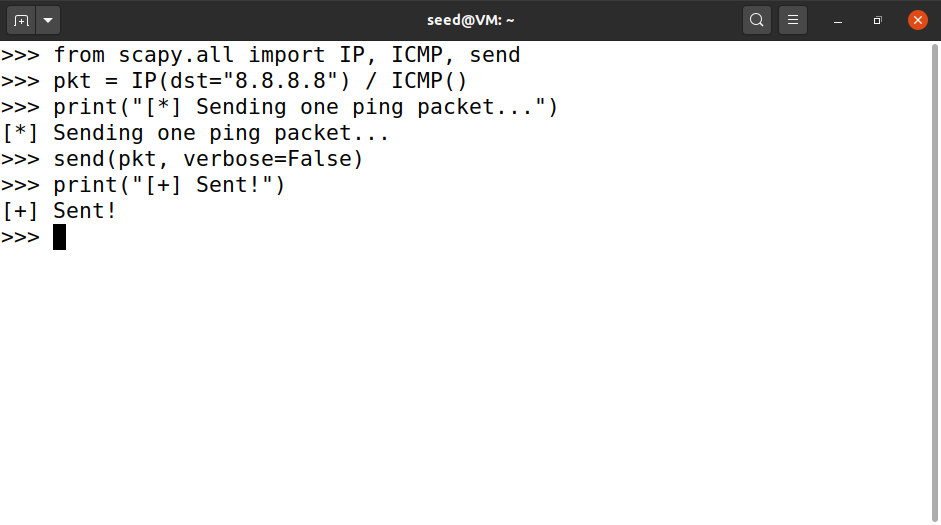

*Figure 13 – The packet is sent and Scapy does not wait for any answer. `verbose=False` hides Scapy's own status lines.*

### 10.2 `sr1()` – send one, receive the first reply

```python
from scapy.all import IP, ICMP, sr1

pkt = IP(dst="8.8.8.8") / ICMP()

print("[*] Sending ping and waiting for reply...")
reply = sr1(pkt, timeout=2, verbose=False)

if reply is None:
    print("[-] No response received (host down or filtered).")
else:
    print(f"[+] Received reply from: {reply.src}")
    print(f"[+] Response TTL: {reply.ttl}")
    print(f"[+] ICMP Type: {reply[ICMP].type}")   # 0 = Echo Reply
```

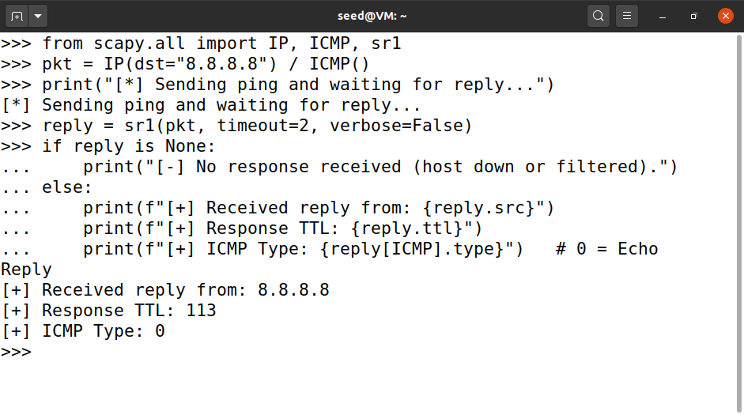

*Figure 14 – A reply arrived from `8.8.8.8`. ICMP type `0` means **Echo Reply**, i.e. the host is alive.*

- `timeout=2` stops the script from waiting forever if the host is down.
- The TTL value of the reply depends on the network path and the lab setup, so it may differ on your machine.

*Script: `scripts/06_send_and_receive.py`*

---

## 11. Lesson 7 – Live sniffing and packet dissection

`sniff()` captures packets in real time.

| Parameter | Purpose |
|---|---|
| `filter` | Berkeley Packet Filter (BPF) expression, the same syntax as tcpdump/Wireshark, e.g. `"tcp and port 80"` |
| `prn` | A function that is run for **every** captured packet |
| `count` | How many packets to capture (`0` = run forever) |
| `store` | `False` = do not keep packets in memory (good for long captures) |
| `stop_filter` | A function that returns `True` when sniffing should stop |

> To see something, you need **traffic**. Open a website in the browser or run `ping 8.8.8.8` in a second terminal while sniffing.

### 11.1 Simple capture

```python
from scapy.all import sniff

packets = sniff(count=5)     # wait until 5 packets are captured
packets.summary()
```

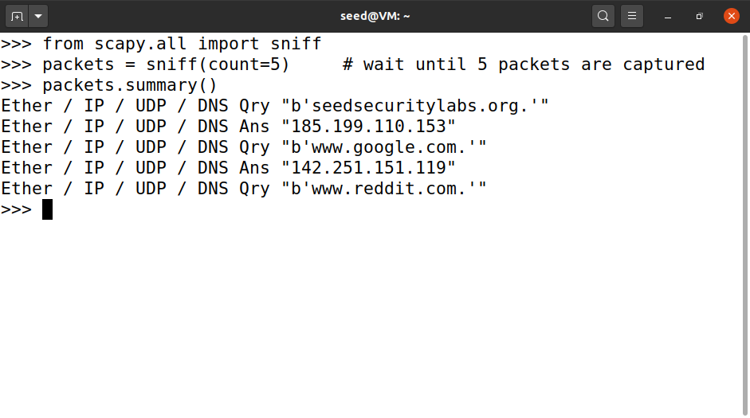

*Figure 15 – While browsing `seedsecuritylabs.org`, five packets were captured: DNS queries (`Qry`) and answers (`Ans`). Each line reads: `Ether / IP / UDP / DNS ...` – the layers of the packet from outside to inside.*

### 11.2 Filtering with BPF

**Only ICMP packets:**

```python
icmp_pkts = sniff(filter="icmp", count=3)
icmp_pkts.summary()
```

To create ICMP traffic, run a ping in another terminal:

```bash
ping 8.8.8.8
```

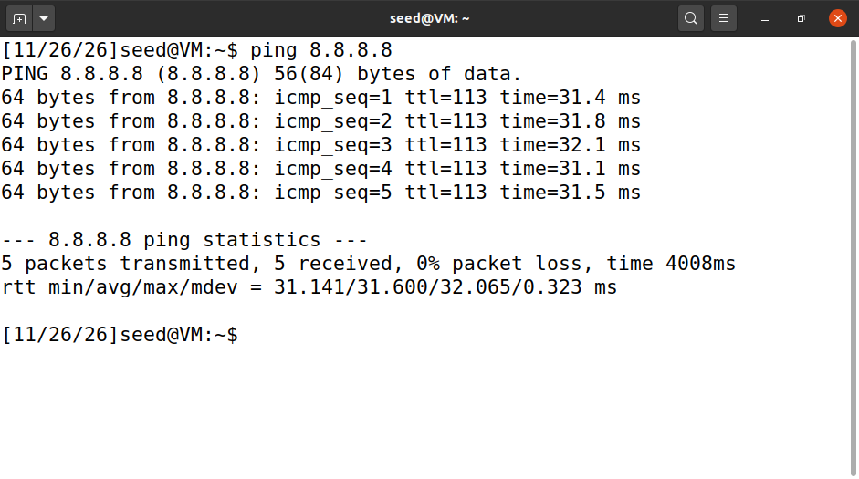

*Figure 16 – The ping that generates ICMP traffic. `56(84) bytes` = 56 bytes of data + 28 bytes of headers.*

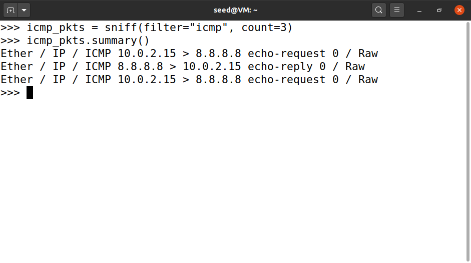

*Figure 17 – Scapy captured the ping: an `echo-request` from `10.0.2.15` to `8.8.8.8`, the `echo-reply` coming back, and the next `echo-request`.*

**Only web traffic (TCP port 80 or 443):**

```python
web_pkts = sniff(filter="tcp and (port 80 or port 443)", count=10)
web_pkts.summary()
```

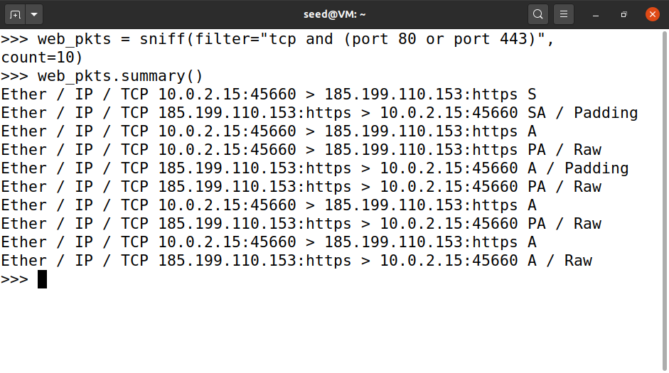

*Figure 18 – Web (HTTPS) conversations between the VM (`10.0.2.15`) and several servers. `PA` and `A` are TCP flags (see the table in 11.3). `Padding` is filler added by the network to reach the minimum Ethernet frame size.*

### 11.3 Real-time processing with `prn` callbacks

Use `prn` to run your own function on each packet the moment it arrives:

```python
from scapy.all import sniff, IP, TCP

def packet_handler(packet):
    if packet.haslayer(IP):
        src_ip = packet[IP].src
        dst_ip = packet[IP].dst
        proto = packet[IP].proto

        info = f"[IP] {src_ip} -> {dst_ip} (Proto: {proto})"
        if packet.haslayer(TCP):
            info += f" | TCP Port: {packet[TCP].sport} -> {packet[TCP].dport} | Flags: {packet[TCP].flags}"
        print(info)

print("Sniffing started. Press Ctrl+C to stop...")
sniff(filter="ip", prn=packet_handler, store=False)
```

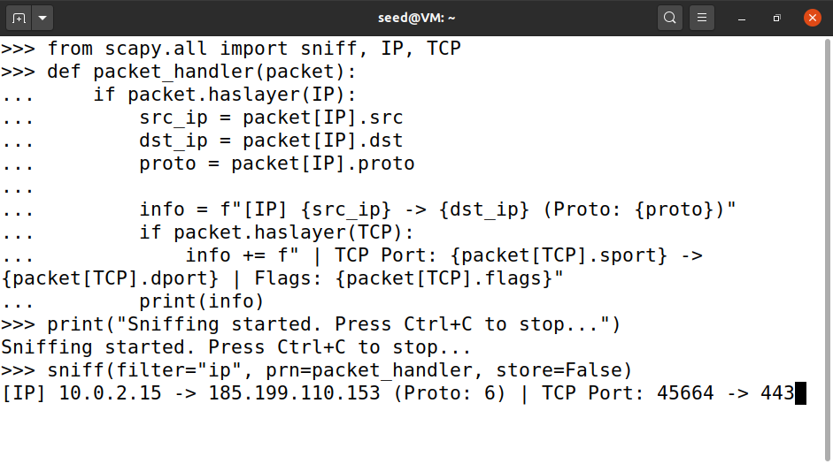

*Figure 19 – A live feed of IP packets. Press **Ctrl+C** to stop.*

**How to read the output**

| Value | Meaning |
|---|---|
| `Proto: 6` | TCP |
| `Proto: 17` | UDP |
| `Proto: 1` | ICMP |
| `Flags: S` | **SYN** – start a connection |
| `Flags: SA` | **SYN-ACK** – server accepts |
| `Flags: A` | **ACK** – acknowledgement |
| `Flags: PA` | **PSH-ACK** – data is being delivered |

The first lines of Figure 19 show the **TCP three-way handshake** with `142.251.150.4` on port 443: `S` → `SA` → `A`, followed by data (`PA`).

`store=False` stops Scapy from keeping every packet in RAM, which prevents memory problems on long runs.

### 11.4 Live DNS request sniffer

A **DNS query** is your computer asking "what is the IP address of this website name?". This tool shows which names are being looked up:

```python
from scapy.all import sniff, DNS, DNSQR, IP

def handle_packet(pkt):
    # Needs both a DNS layer and a DNS Question Record
    if pkt.haslayer(DNS) and pkt.haslayer(DNSQR):
        query = pkt[DNSQR].qname.decode('utf-8', errors='ignore')   # bytes -> text
        src_ip = pkt[IP].src
        print(f"[DNS Query] {src_ip} -> {query}")

print("[*] Starting DNS Sniffer... Press Ctrl+C to stop.")
sniff(filter="udp port 53", prn=handle_packet, store=0)
```

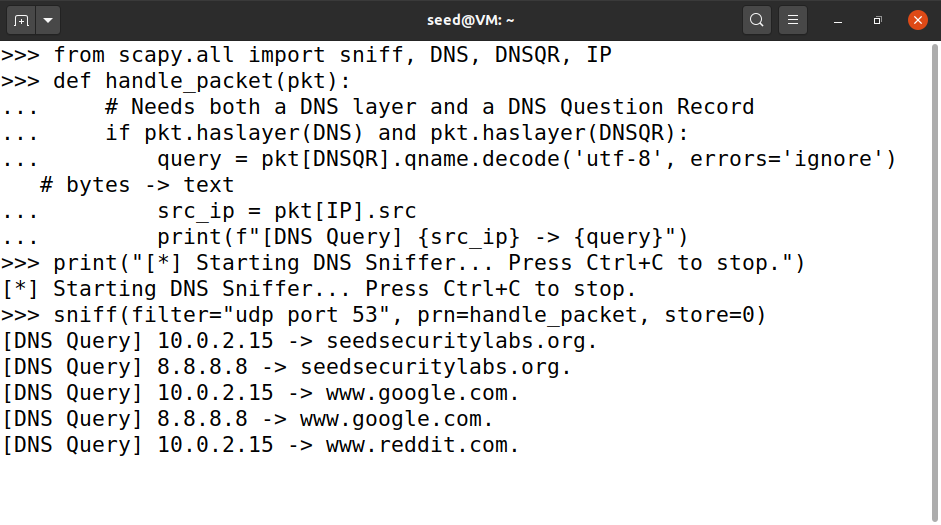

*Figure 20 – While websites were opened, the sniffer printed the names being looked up (`www.reddit.com.`, `www.google.com.`, `www.facebook.com.`, …). The same query can appear more than once, and with different source IPs, because the lab VM may have more than one network path.*

- The BPF filter `udp port 53` keeps only DNS traffic (DNS uses UDP port 53).
- `qname` is stored as bytes (`b'google.com.'`), so `.decode()` converts it to readable text.

*Scripts: `scripts/07_sniff_basics.py`, `scripts/08_sniff_callback.py`, `scripts/09_dns_sniffer.py`*

---

## 12. Hands-on challenges

Try each challenge yourself first, then compare with the solution.

### Challenge 1 – The Detective

> Create an IP packet to `192.168.1.254`. Without sending it, tell which protocol number (`proto`) it defaults to, and change its TTL to 42.

```python
from scapy.all import IP

p = IP(dst="192.168.1.254", ttl=42)
print("Default proto number:", p.proto)
print("TTL is:", p.ttl)
```

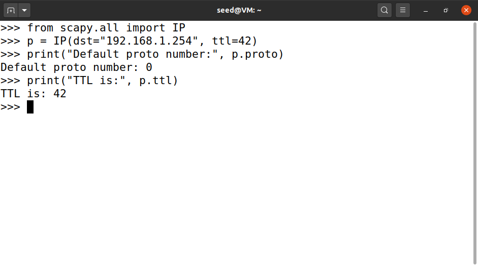

*Figure 21 – Default `proto` is `0` (no upper-layer protocol has been stacked yet) and the TTL is `42`.*

### Challenge 2 – Layer assembly

> Build a UDP packet to `8.8.8.8`, port 53, with the payload `b'test query'`. Print its summary and its hex dump.

```python
from scapy.all import IP, UDP, Raw, hexdump

pkt = IP(dst="8.8.8.8") / UDP(dport=53) / Raw(b"test query")
print(pkt.summary())
hexdump(pkt)
```

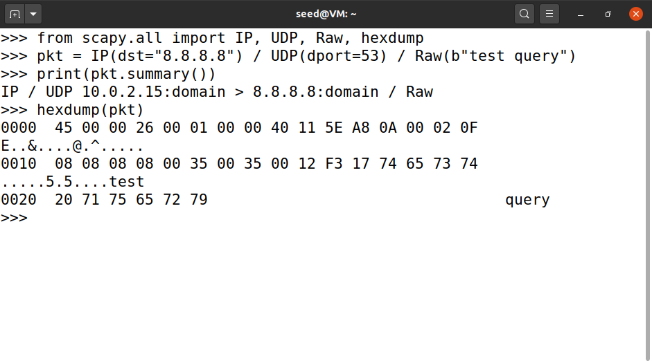

*Figure 22 – The hex dump ends with the ASCII text `test query` (hex `74 65 73 74 20 71 75 65 72 79`). The header shows protocol `11` (hex) = 17 = UDP and total length `0026` = 38 bytes (20 IP + 8 UDP + 10 payload).*

### Challenge 3 – Response inspector

> Send a ping with `sr1()`. Check whether the reply is an ICMP Echo Reply (type 0). If it is, print a message that the host is alive.

```python
from scapy.all import IP, ICMP, sr1

response = sr1(IP(dst="8.8.8.8") / ICMP(), timeout=2, verbose=False)

if response and response.haslayer(ICMP):
    if response[ICMP].type == 0:
        print("[+] Host is alive!")
    else:
        print("Got reply but not an Echo Reply, type is:", response[ICMP].type)
else:
    print("No response received")
```

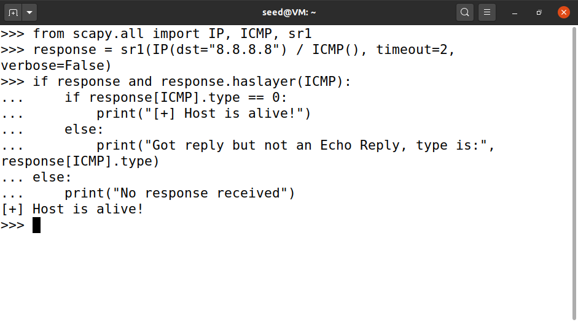

*Figure 23 – The reply is an Echo Reply, so the host is alive. (The original exercise uses `127.0.0.1`; change `dst` to test localhost.)*

*Script with all three solutions: `scripts/10_challenges.py`*

---

## 13. Bonus exercises

### 13.1 Save and load captures (PCAP)

```python
from scapy.all import sniff, wrpcap, rdpcap

pkts = sniff(count=10)
wrpcap("captured_traffic.pcap", pkts)          # save

saved_pkts = rdpcap("captured_traffic.pcap")   # load
print(f"Loaded {len(saved_pkts)} packets.")
```

The `.pcap` file can also be opened in Wireshark. *Script: `scripts/11_bonus_pcap_save_load.py`*

### 13.2 Send your own DNS request

```python
from scapy.all import IP, UDP, DNS, DNSQR, sr1

dns_pkt = IP(dst="8.8.8.8") / UDP(dport=53) / DNS(rd=1, qd=DNSQR(qname="google.com"))

response = sr1(dns_pkt, timeout=3, verbose=0)
if response:
    response.show()
```

`rd=1` means "recursion desired": ask the server to find the answer for us. The `show()` output contains the IP address(es) returned for `google.com`. *Script: `scripts/12_bonus_dns_request.py`*

### 13.3 Simple port scanner

> Only scan machines you own or have permission to test, such as `127.0.0.1` or your own lab VM.

```python
from scapy.all import IP, TCP, sr1

target = input("Target IP: ")

for port in range(20, 101):
    pkt = IP(dst=target) / TCP(dport=port, flags="S")      # send a SYN
    reply = sr1(pkt, timeout=1, verbose=0)

    if reply is not None and reply.haslayer(TCP):
        if reply[TCP].flags == 0x12:                       # SYN-ACK
            print(f"{port}: open")
```

**How it works:** it sends a SYN to each port.

- Reply `SYN-ACK` → the port is **open**.
- Reply `RST` → the port is **closed**.
- No reply → the port is filtered or the host is down.

*Script: `scripts/13_bonus_port_scanner.py`*

---

## 14. Quick reference cheat sheet

| Task | Command |
|---|---|
| List all Scapy commands | `lsc()` |
| List all protocols | `ls()` |
| Show fields of a protocol | `ls(IP)` |
| Create a packet | `IP(dst="8.8.8.8") / ICMP()` |
| One-line description | `pkt.summary()` |
| Full tree view | `pkt.show()` |
| Tree view after build (checksums filled) | `pkt.show2()` |
| Raw bytes | `bytes(pkt)` |
| Hex dump | `hexdump(pkt)` |
| Read a field | `pkt[IP].dst` |
| Does layer exist? | `pkt.haslayer(TCP)` |
| Send, no reply | `send(pkt)` |
| Send, get first reply | `sr1(pkt, timeout=2)` |
| Capture N packets | `sniff(count=N)` |
| Filter capture | `sniff(filter="icmp")` |
| Process each packet | `sniff(prn=my_function, store=False)` |
| Save / load PCAP | `wrpcap("f.pcap", pkts)` / `rdpcap("f.pcap")` |

---

## 15. Glossary

| Term | Meaning |
|---|---|
| **Packet** | A small piece of data sent over a network |
| **Header** | The block of control fields at the start of each layer |
| **Payload** | The actual data carried inside a packet |
| **Layer** | One "envelope" of the packet (Ethernet, IP, TCP, …) |
| **IP address** | The address of a computer on a network |
| **TTL** | Time To Live; the packet is dropped after this many hops |
| **Checksum** | A number used to detect corrupted data |
| **Port** | A numbered "door" on a computer for a particular service (80 = HTTP, 443 = HTTPS, 53 = DNS) |
| **ICMP** | The protocol used by `ping` |
| **TCP / UDP** | The two main ways of delivering data (TCP is reliable and connection-based; UDP is fast and connectionless) |
| **SYN / ACK** | TCP flags used to open a connection and to acknowledge data |
| **DNS** | The system that converts names such as `google.com` into IP addresses |
| **BPF** | Berkeley Packet Filter, the filter language used by tcpdump, Wireshark and Scapy |
| **Sniffing** | Capturing packets that pass through a network interface |
| **PCAP** | A file format for saved packet captures |
| **Raw socket** | Low-level network access that requires root permission |
| **Localhost** | The computer itself (`127.0.0.1`) |

---

## 16. Troubleshooting

| Problem | Solution |
|---|---|
| `Operation not permitted` / `PermissionError` | Run with `sudo` |
| `ModuleNotFoundError: No module named 'scapy'` | `pip3 install scapy` (use `sudo pip3 install scapy` if you run Python with sudo) |
| `sr1()` returns `None` | No reply came back: host down, blocked by a firewall, or no network. Check with a normal `ping` |
| `sniff()` seems to hang | It waits for the requested `count`. Create traffic (open a website, run `ping`) or press Ctrl+C |
| Warnings about matplotlib / PyX / IPython | Harmless; optional extras only |
| `ImportError` for `DNS` / `DNSQR` | Use `from scapy.all import ...` |
| Seeing no packets in a VM | Check the VM's network adapter settings and that you are generating traffic from inside the VM |

---

## 17. Summary

In this lab you learned that:

1. Scapy lets you **explore** protocols with `ls()` and `lsc()`.
2. A packet is built by **stacking layers** with `/`.
3. `show()` displays what you defined; `show2()` shows what is really put on the wire.
4. A packet is ultimately a sequence of **bytes** that you can inspect with `bytes()` and `hexdump()`.
5. `send()` transmits, `sr1()` transmits and returns the first reply.
6. `sniff()` captures live traffic, with **BPF filters** to select packets and **`prn` callbacks** to process them.
7. With only a few lines of Python you can build useful tools such as a DNS sniffer and a port scanner.

Understanding packets at this level is a foundation for network analysis, troubleshooting and security.
